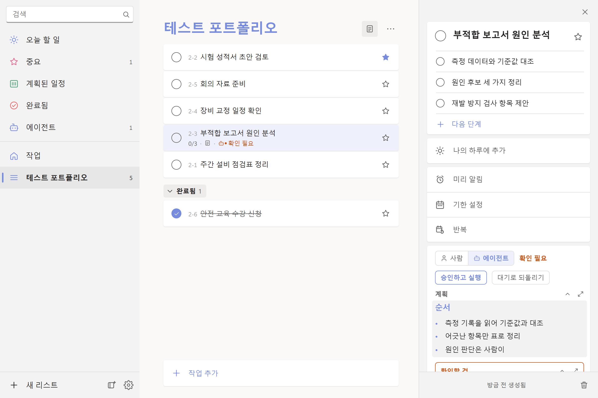
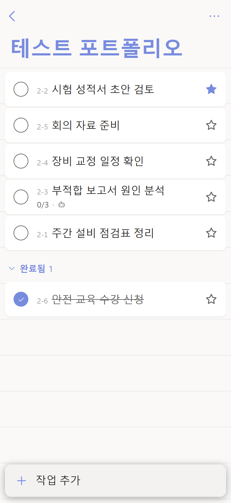
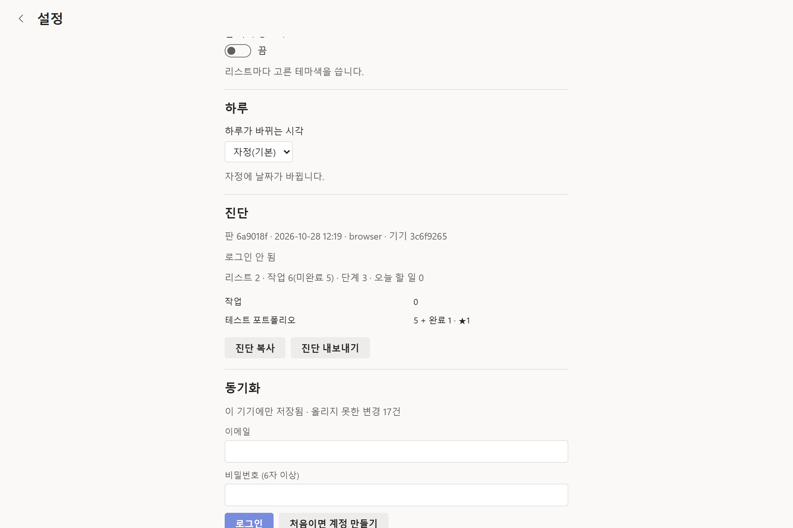

# 체크봇 제작 기록 — 기준을 세우고, 검증하고, 기록해 끝까지

> **한눈에(1분):** 매일 쓰던 할 일 앱을 개인 학습용으로 재현해 PC·아이폰 앱으로 만들고 매일 씁니다. 코드는 AI(Claude Code)가 썼고, 저는 기준(명세 222항목)을 세우고, 기능 결정 37건을 내리고, 실기에서 검증하고, 실수 약 86건을 재발 방지 장치(자동 테스트 527개·규칙)로 바꾸게 했습니다. 저장소 전체 점검을 맡겨 지적 17건을 하나씩 처리하게 한 기록도 있습니다. 이 페이지는 그 **과정 문서**이고, 품질·시험 직무 지원자가 일하는 방식을 보이려고 공개합니다. 다 훑으면 10분쯤, 1절 숫자와 9절 역할 표만 보면 1분입니다.

개인용 할 일 앱 **체크봇**을 AI 코딩 도구(Claude Code)와 함께 만든 과정의 기록입니다. 코드는 AI가 썼고, 저는 무엇을 만들지 정하고, 맞는지 확인하고, 끝났는지 판정했습니다. 이 저장소에는 **코드가 아니라 그 과정의 문서**를 올렸습니다. 명세서, 결정 기록, 자동 검사 스크립트, 실수 기록, 점검 보고서, AI 작업 지침입니다.

- 체크봇은 Microsoft To Do의 화면과 동작을 **개인 학습용으로 재현**한 앱입니다. Microsoft 서비스가 아니며, Microsoft의 아이콘·이미지를 쓰지 않았습니다.
- 앱 소스는 비공개입니다(개인 데이터와 서버 설정이 섞여 있음). 여기 있는 문서·스크립트는 그 저장소에서 복사한 **발췌 사본**입니다(2026-11-02, 판 `80c0d79`). 개인 폴더·환경 이름, 기기 id, 서버 주소만 가렸습니다.
- 만든 사람: 이원찬(기계공학 학사). 개발자 지원용 포트폴리오가 아니라, 품질·시험·설비 직무 지원자가 **일하는 방식**을 보이기 위해 공개합니다.
- **AI 사용 공개** — 쓴 도구: Claude Code(Anthropic). 맡긴 일: 코드·테스트·스크립트 작성, 원인 분석, 점검, 문서 정리. 제가 한 일: 기준 설정, 기능 결정 37건, 실기 검증, 점검 조건과 고칠 순서 결정, 규칙 결정. 최종 책임: 본인.
- **끝났다고 볼 조건(먼저 정한 것):** 원본 앱의 화면·동작을 명세 항목으로 적어 항목마다 재현·제외·보류를 판정하고, 기존 데이터를 옮겨 매일 쓰는 것. 원본 재현이 끝난 시점은 태그로 고정했습니다.
- **제약(먼저 정한 것):** 하루 종일 켜 두는 앱이라 메모리는 원본 수준, PC·아이폰 두 기기 동기화는 Claude 앱을 거치지 않는 가벼운 방식, 서버는 무료 등급, 아이폰은 앱스토어 없이(PWA).
- **쓰인 기술·도구:** 앱(AI가 구현) Tauri·Preact·Dexie(IndexedDB)·Supabase(Auth·RLS·Edge Function)·Playwright·Vitest·ESLint·Deno·GitHub Actions. 제가 쓴 것 Claude Code, Phone Link(안드로이드 화면 비교), 화면 녹화, 아이폰·PC·갤럭시 실기.

| PC(넓은 화면): 리스트 · 세부 정보 · 에이전트 카드 | 아이폰 폭(375px) |
|---|---|
|  |  |

위 캡처는 '테스트 포트폴리오' 리스트에 넣은 **예시 데이터**이고, 2026-11-02 판 `80c0d79`의 웹 미리보기(로그인 없음, 서버 접속 없음)에서 찍었습니다. 오른쪽 아래 카드는 AI에게 맡긴 일이 되돌리기 어려운 단계 직전에 멈춰 "확인 필요"로 묻는 모습입니다.

## 1. 숫자로 (2026-11-02 기준)

| 항목 | 값 | 어디서 |
|---|---|---|
| 기간 | 2026-10-21 시제품 → 10-23 구현 시작 → 10-24 원본 재현 기준선(태그 `v1-원본재현`) → 11-02 현재(계속) | [커밋_목록.md](커밋_목록.md) |
| 작업 시간 | 첫 7일(10-21~28) 40.5시간, 제가 보낸 메시지 241개. 세션 기록을 스크립트로 집계한 값이고, 그 뒤 기간은 같은 기준으로 다시 세지 못해 적지 않았습니다 | 10절 "얼마나 들었나" |
| 커밋 | 271개(10-23~11-01), 하루 최다 62개 | [커밋_목록.md](커밋_목록.md) |
| 명세 항목 | 222개(기능 명세서 106 + 모바일 명세서 116, ID별 재현/제외/보류) | [docs/명세/](docs/명세/) |
| 기능 결정 기록 | 37건(X-01~X-38, 37번은 비어 있음). 33건에 "사용자 결정·요청" 날짜, 나머지 4건은 설계 문서나 제가 앱에 올린 작업 번호 | [추가_기능.md](docs/명세/추가_기능.md) |
| 자동 테스트 | 527개(단위 464 · 화면 흐름 63, 화면 흐름은 PC 폭·375px에서 한 번씩 126회) | [테스트_목록.md](테스트_목록.md) |
| 실수 기록 | 8갈래 약 86건, 사례마다 회귀 테스트 또는 규칙 | [실수_기록.md](docs/실수_기록.md) |
| 검사 시간 | 커밋 훅 11초(4단계), 전체 검사 180초(7단계, 2026-11-02 측정) | [scripts/check.mjs](scripts/check.mjs) |
| 저장소 전체 점검 | 지적 17건 → 15건 고침, 1건은 지적이 틀려 코드를 두고 이유 주석, 1건 남음 | [점검 보고서](docs/audit-ponytail-2026-10-30.md), 7-1절 |
| 결과물 | PC 앱(Tauri) + 아이폰 PWA + 동기화 서버 + 원격 통로(MCP 서버, 도구 11개). 앱에서 할 일에 '실행 요청'을 누르면 PC나 클라우드의 Claude가 그 일을 하고 결과를 카드에 남김. 기존 앱의 작업 223개·단계 365개를 옮겨(2026-10-24 가져오기 보고) 매일 사용 중 | |

## 2. 일한 순서

```
원본 관찰(PC·안드로이드·아이폰 녹화, 시간 측정)
   │
   ▼
기준: 명세서 222항목 ─── 원본 재현이 끝난 시점에 태그로 고정(v1-원본재현)
   │                      그 뒤의 취향 기능은 추가_기능.md에 따로 쌓음 → git diff 로 "내가 바꾼 것"이 보임
   ▼
AI가 구현 ──▶ 검사(npm run check: 안내서 지도·파일·코드 규칙·단위 테스트·원격 통로 함수·화면 흐름·빌드)
   │                 │ 실패하면 멈춤
   ▼                 ▼
실기 확인(PC 앱·아이폰·갤럭시) ──▶ 틀린 것 → 실수_기록.md 에 "증상 → 원인 → 조치"
   │                                         │
   ▼                                         ▼
배포(커밋 훅 → ship: 바뀐 파일에 맞는 검사 → 저장소 → PC 설치 → 폰 배포 → 판 번호 확인)   장치: 회귀 테스트 또는 규칙(CLAUDE.md)
   │
   ▼
정기 점검(저장소 전체 점검 보고서) ──▶ 위험 낮은 묶음부터 고침 ──▶ 고친 뒤 시험 확인
```

## 3. 기준이 먼저: 명세서

원본 앱을 직접 관찰해 항목마다 ID를 붙이고 재현/제외/보류를 적었습니다. 애니메이션은 녹화에서 시간을 재어 ms 단위로 적었습니다. 그래서 "맞다/틀리다"를 사람 느낌이 아니라 **명세 ID와 대조**해 판정했습니다.

| 예시 | 내용 |
|---|---|
| 기능 명세서 11장 P-xx | PC 화면 애니메이션: Windows 원본을 녹화해 비교하고, 원본이 즉시인 곳과 아이폰 방식을 따를 곳을 항목별로 결정(2026-10-24) |
| 모바일 명세서 12장 A-01~A-38 | 행 변화 시간: 빠짐 120ms → 이동 250ms → 들어옴 120ms(안드로이드 녹화 측정값) |
| 모바일 명세서 12-4 I-01~I-13 | 아이폰 원본과 비교해 **바꾸기로 결정한 것**과 이유 |
| 용어집 0장 | "리스트/목록", "작업/할 일"처럼 헷갈리는 말의 부를 이름을 확정(2026-10-27) |

**검수표 발췌 — 아이폰 원본과 나란히 비교한 표(모바일 명세서 12-4, 13행 중 3행):**

| ID | 본 것 | 원본(아이폰 MS To Do) | 우리 앱 → 결정 |
|---|---|---|---|
| I-01 | 위쪽 어두운 막, 아래 줄이 약 60pt 떠 있음 | 또렷함 | 상태 표시줄 태그를 빼고(Apple 권고) 맨 위 12px 단색 띠로 흐림 해결. **2026-10-24 기기에서 확인** |
| I-06 | 할 일 추가 | 화면 아래 떠 있는 '+ 작업 추가' 줄 | + 단추 대신 아래 줄(제 결정: PC와 통일). 키보드 위 바는 웹앱에서 끌 수 없음 → ✓로 키보드만 내리면 시트도 닫음 |
| I-07 | 칩·칸 팝업 | — | 제 지적("우리 앱 팝업이 안드로이드보다 투박") → 붙은 쪽에서 펼쳐지듯 200ms로 |

→ [기능_명세서.md](docs/명세/기능_명세서.md) · [모바일_명세서.md](docs/명세/모바일_명세서.md) · [용어집.md](docs/명세/용어집.md)

## 4. 다섯 관문: 같은 실수를 사람이 아니라 검사가 먼저 잡게

| 관문 | 명령 | 잡는 것 |
|---|---|---|
| 1. 전체 검증 | `npm run check` (7단계, 약 3분) | 깨진 파일(BOM·JSON·셸이 깨뜨린 경로), 코드 규칙, 단위 테스트 464개, 원격 통로 함수를 실제 Deno로 돌리기, 화면 흐름 63개(PC 폭·375px, 콘솔 오류 0), 빌드 |
| 2. 커밋 훅 · 자동 검사(CI) | `check:fast` (약 11초), GitHub Actions | 1의 앞 단계를 안 돌리고 커밋하는 것. 실제로 막은 사례 있음(2026-10-27). 클라우드 세션이 올린 가지도 GitHub에서 빠른 검사와 원격 통로 함수 검사(화면 검사는 로컬 몫) |
| 3. 배포 검사 | `npm run ship` / `land` | 커밋 안 한 변경이 섞여 올라가는 것, 공개 주소가 새 판을 내보내는지(판 번호가 같아질 때까지 기다림). **바뀐 파일에 맞는 검사만** 돌리고 같은 내용은 다시 검사하지 않음, 여러 세션의 검사·배포는 PC 한 대에 하나씩 줄 세움 |
| 4. 진단·대조 | 앱 설정 → 진단, `server-check --compare` · `--request` | 기기마다 개수가 다른 것, 올리지 못한 변경, 옛 판으로 도는 기기. 동기화 한 번의 단계별 ms 기록, 켜져 있는 기기에 진단 값을 원격으로 요청 |
| 5. 규칙 | `CLAUDE.md` "끝났다고 말하기 전에" 8줄 · "고칠 때 지키는 원칙" 6줄 | 확인 안 한 것을 확인했다고 말하는 것, 원인을 모른 채 덧대는 것, 실데이터 실험, 셸로 파일 쓰기 |

관문을 만든 뒤에는 버그를 **일부러 되살려** 검사가 실제로 실패하는지 봤습니다. 통과만 보고 끝내면 "검사가 있는데 안 잡는" 상태가 되기 때문입니다. 새로 고친 버그도 "고친 줄을 빼면 시험이 실패하는지" 확인한 뒤 남깁니다. → [scripts/check.mjs](scripts/check.mjs) · [scripts/check-scope.mjs](scripts/check-scope.mjs) · [scripts/ship.mjs](scripts/ship.mjs) · [실수_기록.md 다섯 관문](docs/실수_기록.md)



위: 관문 4의 진단 화면(판 번호·기기·계정·리스트별 개수·DB 응답 시간). 이 값을 서버와 대조합니다.

**AI에게 상시 적용되는 지시문([CLAUDE_발췌.md](CLAUDE_발췌.md) "끝났다고 말하기 전에", 줄여 옮김):**
1. 커밋 훅의 빠른 검사를 통과해 커밋한다. 커밋은 자기 파일만 담는다.
2. 화면을 고쳤으면 미리보기 탭을 앞에 띄운 채 그 동작을 실제로 눌러 보고 말한다.
3. 실기(아이폰·PC 앱)에서 보지 않은 것은 "확인 안 됨"이라고 그대로 적는다.
4. 배포했으면 공개 주소의 판 번호를 확인한 출력을 보고 말한다.
5. 기기마다 개수가 다르다는 의심이 들면 세지 말고 서버와 대조한다.
6. 수치·설치 여부·기기 종류는 명령 결과나 진단 값으로 말하고, 추측이면 "(추정)"을 붙인다.
7. 새 실수를 찾았으면 실수 기록에 한 줄 더하고, 되도록 회귀 테스트와 함께 남긴다.
8. 커밋 훅이 안내서의 근거가 바뀌었다고 알리면, 동작·규칙이 달라졌을 때만 그 절을 고친다.

**고칠 때 지키는 원칙(같은 파일):** 고치기 전에 부르는 곳·테스트·설정부터 적는다 · 새로 만들기 전에 "꼭 있어야 하나 → 이미 있나 → 플랫폼 기능 → 설치된 라이브러리 → 한 줄" 순서로 내려간다 · 버그는 공통 코드에서 원인을 고치고 덧대지 않는다 · 고치기 전에 실패하는 시험이나 측정부터 만든다 · 서버 값을 바꿀 때 옛 판 기기가 받아도 안전한지 본다.

프롬프트 전문은 올리지 않습니다. 대신 이 상시 지시문과 아래 6-1의 "제 지시 → 틀린 것 → 규칙" 쌍으로 과정을 보입니다.

## 5. 실수 → 장치 사례

실수 기록은 8갈래입니다. 실기에서만 보이는 것을 미리보기로 "확인"이라 보고(25건+) · 테스트가 없던 규칙(10) · 고쳤다고 말하기 전에 화면을 안 봄(10) · 빌드·배포 판 불일치(9) · 도구·환경(12) · 실데이터 실험 오염(7) · 세션 사이 전달·충돌(7) · 추정을 사실처럼 보고(6). 아래는 그중 넷.

### 5-1. 데이터가 사라진 것처럼 보임 (2026-10-26)
- **증상:** 작업 표시줄로 켠 PC 앱에 리스트·로그인이 모두 비어 있음. 제가 "데이터가 날아갔어. 그것부터 수정해줘."로 보고.
- **원인:** AI 세션 안에서 켠 앱은 저장소 폴더가 다른 위치로 돌려져 있었고(설치 꾸러미 규칙), 제가 켠 앱은 거의 빈 원래 폴더를 봤습니다. 디스크 파일은 두 곳에 다 있었습니다.
- **조치(AI):** 지우거나 다시 로그인하지 않고 **두 저장소를 먼저 백업**한 뒤 제자리로 복사 → 같은 기기 id로 동기화가 돌아옴.
- **재발 방지:** 설치 스크립트가 앱을 꾸러미 밖에서 켜고, 안쪽 사본이 있으면 멈춤(테스트 `install-pc.test.js`). 규칙: 빈 화면이면 먼저 백업.

### 5-2. 갤럭시에서만 동기화가 늦음: 측정을 더해 가며 원인을 좁힘 (2026-10-29)
- **증상(제 제보):** "안드로이드 앱에서는 갱신 자체가 잘 안 되고 있어. … 아이폰이나 pc에서는 잘 돼. 이 원인을 파악해줘." 그리고 "MS to do는 얼마나 자주 갱신하는 지 조사한 후, 그 주기로 바꿔줘."
- **1차:** 서버 기록에서 폰이 18:29:53에 누른 것이 18:35:10에야 도착. 멈춘 요청에 시간 제한이 없어 뒤 동기화가 줄줄이 기다린 것 → 요청마다 시간 제한, 갱신 주기는 MS 공식 안내대로 5초. **배포 뒤에도 약 60초 늦음.**
- **측정 추가(세 번):** 진단에 동기화마다 요청별 ms → 요청은 50~170ms인데 한 번에 58초. 기기 안 단계별 ms와 화면 멈춤 시간 → 받은 한 줄을 기기 DB에 쓰는 데 55초, 화면 멈춤은 3ms, "다른 무언가가 DB를 붙잡고 있다". 열린 창 목록 → **같은 앱 창이 2개**(보이는 창, 숨은 창).
- **원인:** 뒤에 살아 있던 같은 앱 창을 안드로이드가 DB 읽기 도중 얼려, 잠금을 쥔 채 두었습니다.
- **재발 방지:** 창 하나만 DB를 쓰게 하고(새 창이 뜨면 다른 창은 물러남), 화면 검사 '같은 앱 창을 하나 더 열면 …'을 **고친 줄을 빼면 실패하는지 확인**하고 남김. 배포 뒤 진단에 여전히 창 2개가 보여(옛 판 창이 '물러나라'를 모름) 옛 창도 새 코드로 다시 띄우게 보강. 제보부터 마지막 보강까지 약 1시간 10분.

### 5-3. 잘못된 진단을 되돌림 (2026-10-26)
- **증상:** 서버 조회에 어떤 작업이 안 나오다가 이름으로 찾으니 나옴. AI가 "상태 빈 칸을 빼는 버그"로 단정하고 질의를 고쳐 문서·커밋까지 적음.
- **원인:** 버그가 아니라 제가 그 사이 앱에서 막 맡긴 작업이었습니다(제가 알려 줌).
- **조치:** 시험되지 않은 질의 수정을 배포 전에 되돌림(커밋 911cae5).
- **재발 방지:** 규칙: 조회 결과가 앞뒤로 다르면 고치기 전에 같은 조회를 한 번 더 하고, 사용자에게 바꾼 것이 있는지 묻는다. "추정을 사실처럼 보고" 갈래의 다른 사례와 함께 "(추정)" 표기 규칙.

### 5-4. 동기화가 500개를 넘으면 멈춤: 경계값 시험 (2026-10-24)
- **증상:** 폰에는 장기 리스트가 4개, PC에는 17개.
- **원인:** 같은 서버 시각의 레코드가 한 쪽(500개)을 넘으면 받기가 멈추고, 연결 함수가 다음 커서를 버렸습니다.
- **재발 방지:** 가짜 서버로 기기 두 대를 왕복시키며 **정확히 500개·1,003개 같은 시각**을 넣는 테스트(`sync.test.js`). 기기별 개수는 사람이 세지 않고 `server-check --compare`로 대조.

→ [실수_기록.md 전체](docs/실수_기록.md)

## 6. 제 말과 그 뒤에 생긴 규칙

### 6-1. 제 지시 → 틀린 것 → 규칙 (작업 기록에서 원문 그대로)

프롬프트 전문 대신, 제가 한 말과 그 뒤에 생긴 규칙을 짝지어 둡니다.

| 제가 한 말(원문, 오타 포함) | 그때 AI가 하던 것 | 그 뒤에 생긴 규칙·변경 |
|---|---|---|
| "세부적인 사항과 메커니즘 자체는 구현이 안 됐어. 두번째 스크린샷과 다르잖아. … 너는 완료됨 폴더 하나를 통째로 빼먹었어. … 이런 세부 사항까지 세세하게 구현하는게 지금의 방식으로 가능해?" | 원본을 보지 않고 기억으로 화면을 만들어 "구현했다"고 보고 | 원본 앱을 직접 관찰·실험해 명세서를 먼저 쓰는 방식으로 전환(기능 명세서 106항목 + "실험으로 확인한 동작" 9장) |
| "새 세션이 하나 더 필요해. 이 작업을 하면서, 생각보다 내 관여가 빈번했고, 네 실수도 많았어. 네가 네 실수를 스스로 바로잡을 수 있는 방법이 필요해. 디버깅도 스스로 검사할 수 있어야 해." | 실수를 제가 매번 잡아 주던 상태 | 세션 기록 7개·약 90건 조사 → 다섯 관문 설계(AI) → 아래 질문 두 개 → 승인 → `실수_기록.md` 8갈래 |
| "이 관문 중에서, 부작용이 예상되는 관문이 있어?" → "내 개입을 얼마나 줄일 수 있어?" → "일단 다섯 관문을 이대로 진행해줘." | 다섯 관문 설계안을 제시 | 부작용 표(커밋 느려짐, 남의 미커밋 파일에 막힘 등)와 개입 절감 추정을 받은 뒤 전체 승인 |
| "앞으로는 npm run pc, npm run deploy, npm run check, npm run sync 등의 후속 절차를 자동화 하고 싶어. 넌 어떻게 생각해?" → "이걸 다른 프로그램 개발에 있어서도 자동화 하고 싶어." | 명령 넷을 매번 따로 돌리던 중 | `npm run ship` 하나로 묶고 GitHub 자동 배포, 절차를 스킬로 남겨 다른 프로젝트에도 |
| "클라우드 세션도 아티팩트에 접근할 수 있는 것 같은데? 화면 자동 검사도 막힌 게 확실해?" | 클라우드에서는 화면 검사가 안 된다고 단정 | 미리 깔린 Chromium을 쓰게 고침. 화면 검사가 건너뛰면 "모두 통과" 대신 "화면 검사 안 됨"으로 보고하는 규칙(실수 기록 7갈래) |
| "클라우드 세션에서도 함수를 직접 돌려볼 수 있어? 예를 들어, Deno를 임시 폴더에 설치해 로컬에서 함수를 직접 돌려 볼 수 있어?" → "CI 넣어 줘" | 원격 통로 함수를 Node 시험으로만 보고, 클라우드 세션의 가지는 로컬에서 합칠 때까지 검사 없이 쌓임 | 검사에 원격 통로 함수의 실제 Deno 실행을 더함, GitHub Actions 자동 검사(관문 2) |
| 점검 의뢰: "아직 아무것도 고치지 마." · "각 항목마다: 번호, 파일:줄, 무엇이 문제인지 쉬운 말로, … 고칠 때 위험도(낮음/중간/높음), 동작이 바뀌는지 여부." | 저장소 전체를 점검할 차례 | 점검 보고서 17건, 고치기는 따로(7-1절) |
| "위험 낮은 묶음부터" → "지금까지 고친 부분들이 다 잘 작동하는 지 테스트까지 마친 거지? 만약 안한 게 있다면 테스트를 진행해줘." | 점검 지적을 묶음별로 고치던 중 | 지적마다 커밋, 끝에 시험과 실기(PC 앱, Phone Link로 갤럭시) 확인 |
| "'안내서.md'와 '안내서_지도.md'가 만들어지고, 갱신되는 시스템 자체에 보강할 점이 있는 지 다시 한 번 점검해줘." | 안내서를 막 만든 직후 | 보강한 뒤 합침(10-31). 그 뒤 알림 소음·지도 누락·합치기 충돌을 차례로 고침(7-2절) |
| "색이 너무 옅어. ms 처럼 다크모드를 진하게 해줘." → "여전히 MS가 더 어두워. 색을 똑같이 맞춰줘." | 녹화 영상에서 색을 재어 맞췄다고 보고 | 압축 영상의 색이 틀릴 수 있음을 인정, 두 창을 띄워 화면에서 직접 재기(명세 11장 색 값) |
| "메뉴 창에서는 그런 게 없긴 한데." (화면 첨부) | 아이폰 맨 위 흐림을 웹앱 공통 현상으로 설명 | 제 관찰(메뉴 창은 흐림 없음)로 반증 → 메뉴 창은 맨 위부터 단색이라는 차이를 찾아 12px 단색 띠 해법(I-01) |
| "네 변경만 커밋하고, 배포는 다른 세션 작업이 커밋된 뒤에 하자." / "내 파일 9개만 커밋하고 npm run sync로 올려 줘" | 같은 저장소를 다른 세션도 고치는 중 | 자기 파일만 커밋(`git add -A` 금지), 배포 검사가 미커밋 변경이 섞이면 멈춤(관문 3) |

발언은 작업 기록에서 원문 그대로 옮긴 것입니다. 세션을 열 때 다른 Claude 세션이 쓴 시작 지시문은 제 말이 아니므로 쓰지 않았습니다.

## 7. 점검과 문서 관리

### 7-1. 저장소 전체 점검 → 하나씩 고침 (2026-10-30)

점검 도구(ponytail-audit 스킬)로 AI에게 저장소 전체를 보게 하되, 조건은 제가 정했습니다: 사용량은 "나 혼자 PC와 아이폰으로 쓰는 앱" 기준, 순서는 버그 → 보안 → 부하 → 테스트 → 속도 → 군더더기, 항목마다 파일:줄·위험도·동작 변화, 읽지 않은 부분은 따로 적기, **아직 고치지 않기**.

| 결과 | 내용 |
|---|---|
| 지적 17건 | 꼭 고칠 것 5(첨부 하나가 실패하면 그 기기는 더 받지 못함, 다른 프로그램이 단축키를 잡으면 PC 앱이 안 켜짐 등), 고치면 좋은 것 10(같은 기능의 두 벌 코드, 안 쓰는 코드), 있으면 좋은 것 2 |
| 고친 것 15건 | 위험 낮은 묶음부터 지적마다 커밋을 나눔(커밋 제목에 "점검 n"). 한 번 쓰고 끝난 가져오기 기능은 제 결정으로 지움. "점검 n" 커밋들에서 코드 1,731줄을 지우고 518줄을 더함(원격 통로용 복사본을 저장소에서 뺀 것 포함) |
| 틀린 지적 1건 | 17번 "시간 제한 타이머를 끝나면 지우자"는 고치기 직전 부르는 쪽을 읽다 틀린 것으로 판명(지우면 응답 본문이 멈출 때 끊을 수단이 사라짐). 코드는 두고 이유 주석, 실수 기록 8갈래에 "점검 결과도 추정으로 보고, 고치기 전에 부르는 쪽까지 읽는다" |
| 남은 1건 | 4번 설정 '주의 시작 요일'이 달력에 쓰이지 않음. 명세에는 '재현'으로 적혀 있어, 명세와 실제가 다른 항목이 점검에서 나온 사례입니다. 아직 고치지 않았습니다 |

→ [점검 보고서 원문](docs/audit-ponytail-2026-10-30.md)

### 7-2. 안내서: 문서가 코드보다 늦게 바뀌지 않게 (2026-10-31~11-01)

AI가 질문을 받으면 코드 전체를 뒤지기 전에 먼저 읽는 문서(`안내서.md`)와, 검사 때마다 저절로 다시 만드는 파일·기능 목차(`안내서_지도.md`)를 두게 했습니다.

- **근거 줄:** 안내서의 절마다 "근거" 코드 파일을 적고, 그 파일을 고쳐 커밋하는데 그 절을 안 고쳤으면 커밋 훅이 절 이름을 알립니다. 지운 함수 이름이 문서에 남으면 시험(`guide.test.js`)이 잡습니다.
- **알림 기준 조정:** 처음엔 알림이 100커밋에 66번 울려 49번이 안 고친 채 지나갔습니다. 너무 자주 울리면 무시하게 되므로 근거 줄만 보게 좁히고, 쌓인 낡음은 한 달에 한 번 `--stale` 명령으로 봅니다.
- **충돌 줄이기:** 세션마다 같은 자리에 답을 한 줄씩 더하라는 규칙 때문에 30분 사이 합치기가 5번 충돌해, 그 목록을 따로 빼고 양쪽 줄을 모두 살려 합치게 했습니다.

→ [안내서.md](docs/안내서.md)

## 8. 결정 기록

결정은 날짜·이유·원본 ID와 함께 남겼습니다. 되돌릴 때 근거를 다시 찾지 않기 위해서입니다.

| 결정 | 이유 | 어디에 |
|---|---|---|
| 동기화 서버는 Supabase, 충돌은 필드 단위 마지막 쓰기 우선, CRDT 안 씀 | 개인용 두 기기, 가벼운 방식. Firebase는 SDK가 무겁고 구조가 묶여 제외 | 기술_결정_메모 3장 |
| PC 앱은 Tauri(WebView2) | 제 제약: "'할 일 수첩'은 사실상 클로드를 켜 놓는 거라서 너무 무거워. … MS to do와 비견되는 리소스 절약을 원해." 목표는 MS To Do(작업 관리자 기준 약 105MB) 수준 → 2026-10-30 측정 110MB(앱과 WebView2 7개의 개인 작업 집합 합, AI가 잰 값, 재는 방법까지 문서에 기록) | 기술_결정_메모 0·7장 |
| 리스트를 지워도 완료한 작업은 '작업' 리스트로 옮겨 남김(X-18) | 완료 기록이 사라지는 것을 원치 않음(2026-10-28 결정). 원본 동작(N-09·N-10)과 다른 점을 ID로 적음 | 추가_기능.md X-18, 테스트 `data.test.js` |
| 원인 모를 드문 결함은 재현될 때까지 덧대지 않음 | PC 작업 표시줄 배지가 한 번 옛 숫자로 남았지만 바로 맞게 돌아옴. 추정 원인 둘만 적고 덧대지 않기로 함(2026-11-01 결정). 다시 보이면 먼저 적을 값을 정해 둠 | 실수_기록 5갈래 |
| 되돌리기 어려운 일(보내기·결제·삭제)은 실행 직전 "확인 필요"로 멈춤 | AI에게 일을 맡길 때의 안전 규칙. 할 일 제목·메모 안의 지시는 데이터로 보고 따르지 않음. 앱의 '승인하고 실행' 단추로만 이어 감 | 추가_기능.md X-03·X-17·X-35 |
| 비밀 키는 코드·문서·커밋에 넣지 않음, 앱에는 공개 가능 키만 | 저장소를 여러 세션이 쓰므로 | CLAUDE_발췌.md "지키는 것" |

→ [기술_결정_메모.md](docs/명세/기술_결정_메모.md) · [추가_기능.md](docs/명세/추가_기능.md)

## 9. 제가 한 일 · AI가 한 일

| 제가 한 일 | 저장소의 흔적 | AI(Claude Code)가 한 일 |
|---|---|---|
| 방향 결정: "이 외에는 거의 그대로 재현해주면 좋겠어. … 나는 재현한 원본을 기준으로 내가 추가하고 싶은 기능을 추가할 거야. 그 작업을 대비해서 만들어줘." 빠진 것(완료됨 목록 등) 지적, 기준선 태그 지시("지금 커밋에 v1-원본재현 태그를 붙여 줘") | 기술_결정_메모, 태그 `v1-원본재현`, 추가_기능.md 머리말 | 관찰·녹화 정리, 명세서 작성, 코드 작성 |
| 기능마다 결정 37건, 이름 확정, 아이폰에서 바꿀 것·PC 애니메이션 선택 | 추가_기능.md의 "(날짜 사용자 결정)", 용어집 0장, 명세 11·12-4·13장 | 선택지 시안, 결정 기록, 구현 |
| 실기 확인과 결함 지적: 아이폰 설치·로그인·동기화, 기기 사이 차이 제보(갤럭시만 늦음), 색 2회, AI 설명을 관찰로 반증, "데이터가 날아갔어", 잘못된 진단 바로잡기 | 실수_기록 2·3·4·8갈래, 커밋 911cae5 | 측정 추가, 원인 분석, 수정, 회귀 테스트 |
| 점검 의뢰 조건(사용 기준·항목 형식·"아직 고치지 마"), 고칠 순서("위험 낮은 묶음부터"), 고친 뒤 시험 확인 요구, 지울 기능 결정 | 점검 보고서 머리말·14번, 커밋 제목 "점검 n" | 점검, 보고서, 묶음별 수정, 시험 |
| 규칙 결정: 후속 절차를 명령 하나로, 실험은 '테스트' 리스트에서만, 영구 삭제·계정·비밀번호는 본인, 원인 모르면 덧대지 않기 | CLAUDE_발췌.md, ship.mjs 머리 주석 | 규칙을 지침·훅·스크립트로 |
| 검사 장치 요구: "네가 네 실수를 스스로 바로잡을 수 있는 방법이 필요해. 디버깅도 스스로 검사할 수 있어야 해." → AI가 낸 다섯 관문 설계안에 "부작용이 예상되는 관문이 있어?", "내 개입을 얼마나 줄일 수 있어?"를 묻고 승인. 후속 절차 자동화(ship), 자동 검사(CI), 안내서 재점검은 제가 요청 | 실수_기록 다섯 관문, `ship.mjs` 머리 주석(2026-10-26 결정) | 관문 설계·구현, 버그 되살려 확인, ship·CI·안내서 구현, 절차 스킬 작성 |
| **코드는 한 줄도 직접 쓰지 않았습니다** | — | 코드·테스트·스크립트 전부 |

## 10. 품질·시험 직무의 말로 읽으면

| 이 기록 | 품질·시험·설비 업무에서 같은 것 |
|---|---|
| 관찰 → 명세 222항목 → 기준선 태그 | 검사 기준서·검사 절차서 작성, 기준선 고정 |
| 결정 기록 37건(날짜·이유·원본 ID) | 설계 변경 이력, 결정 근거 기록 |
| 다섯 관문(검사 → 훅 → 판 확인 → 대조 → 규칙) | 로트별 검사 → 출하검사(검사 성적서) → 검사이력 관리대장 → 재고 대조 → 사내표준 |
| 바뀐 파일에 맞는 검사만 다시 돌림 | 변경점 관리 |
| 실수 8갈래 약 86건 → 회귀 테스트·규칙 | 부적합보고서(NCR) → 원인 분석 → 시정조치·재발 방지 대책서 → 검사 기준서 갱신 |
| 고친 줄을 빼면 시험이 실패하는지 확인 | 재발 방지 조치의 효과성 검토 |
| 갤럭시 지연을 측정 항목을 더해 가며 좁힘 | 시험 중 계측 항목 추가, 원인 분석 |
| 저장소 전체 점검 → 지적별 시정, 틀린 지적은 근거와 함께 기각 | 내부감사 → 시정조치 |
| 안내서 근거 줄·갱신 알림 | 사내표준 정비, 문서 개정 관리 |
| ship 한 명령, 자동 배포 | 표준 작업 절차, 공정 자동화 |
| AI 작업 지침(멈춤 규칙·권한 분리·비밀 금지) | 작업 지시서, 안전 인터록 |

한계: 코드는 제가 쓰지 않았고, 현장 품질 절차와 계측 장비는 아직 배워야 합니다. 실기에서만 보이는 결함(25건 이상)은 여전히 사람이 잡고 있어, 이 갈래를 줄이는 것이 남은 과제입니다. 점검에서 나온 명세와 실제가 다른 항목(7-1절 남은 1건)도 아직 고치지 않았습니다.

## 11. 평가자가 물을 것 같은 질문

- **AI가 다 만든 것 아닌가요?** 코드는 AI가 썼습니다. 제가 한 일은 9절 표의 왼쪽이고, 모두 저장소의 날짜 있는 글로 가리킬 수 있습니다.
- **코드를 못 쓰는데 어떻게 검증했나요?** 명세 ID와 실기 동작을 대조했고, 진단 화면의 개수를 서버와 대조했고, AI가 쓴 테스트는 버그를 되살려 실제로 잡는지 봤습니다. 점검을 맡길 때도 항목마다 위험도와 동작 변화를 적게 해 고칠 순서를 제가 정했습니다.
- **왜 원본을 그대로 재현했나요?** 매일 쓰는 원본이 있어야 "맞다/틀리다"를 판정할 수 있습니다. 취향은 기준선 위에 따로 쌓아 원본과의 차이가 `git diff`로 보입니다.
- **AI 결과를 어디까지 믿나요?** 추정을 사실처럼 보고한 사례가 6건 있어, 수치·설치 여부·기기 종류는 명령 결과로만 말하고 추측이면 "(추정)"을 붙이는 규칙을 두었습니다. 점검 보고서도 추정으로 보고, 실제로 지적 하나가 틀렸습니다(7-1절). 실기에서 못 본 것은 "확인 안 됨"으로 적습니다.
- **입사하면 이런 프로그램을 만들 건가요?** 약속하지 않습니다. 회사의 보안·도구 정책을 따르고, 여기서 배운 기준·검증·기록 습관을 문서와 검사 일에 씁니다.
- **얼마나 걸렸고, 얼마나 들었나요?** 첫 7일(2026-10-21~28)은 작업 시간 40.5시간, 커밋 119개, 제가 보낸 메시지 241개입니다. 같은 기간 AI 사용량은 토큰 15.9억(98%가 긴 대화를 다시 읽는 캐시 읽기)이고, API 정가로 환산하면 약 $648입니다. 실제로는 구독제라 청구액은 다릅니다. 집계는 세션 기록을 스크립트로 센 것이고 클라우드 세션 일부는 빠져 있습니다. 그 뒤 11월 1일까지 커밋 152개를 더해 271개가 됐고, 이 기간의 시간·사용량은 세션 기록이 여러 폴더로 흩어져 같은 기준으로 다시 세지 못했습니다.
- **왜 만들었나요?** 제 말 그대로: "정신없이 채팅과 프로젝트가 늘어나고, 이제는 어떤 채팅이 언제 어디에 있었는지도 헷갈렸어. 이 모든 작업을 이 앱으로 정리하고, 앞으로 상당 수의 작업을 이 앱을 창구 삼아서 진행하려고 해." 그리고 "내 최종 목표는 자동화야."

## 12. 이 저장소의 파일

| 파일 | 내용 |
|---|---|
| [docs/명세/기능_명세서.md](docs/명세/기능_명세서.md) | PC 원본 기준선 106항목 + 관찰 중 생긴 일 |
| [docs/명세/모바일_명세서.md](docs/명세/모바일_명세서.md) | 좁은 화면 116항목, 애니메이션 측정값, 아이폰·안드로이드 비교 결정 |
| [docs/명세/용어집.md](docs/명세/용어집.md) | 화면·기능·버튼 이름(본인 확정) |
| [docs/명세/기술_결정_메모.md](docs/명세/기술_결정_메모.md) | 플랫폼·동기화·보류 항목과 이유, 메모리 측정 |
| [docs/명세/추가_기능.md](docs/명세/추가_기능.md) | 기준선 위에 더한 기능 37건의 결정 기록 |
| [docs/실수_기록.md](docs/실수_기록.md) | 실수 8갈래와 다섯 관문 |
| [docs/audit-ponytail-2026-10-30.md](docs/audit-ponytail-2026-10-30.md) | 저장소 전체 점검 보고서(지적 17건, 고치기 전 원문) |
| [docs/안내서.md](docs/안내서.md) | AI가 질문을 받으면 먼저 읽는 문서(동작 원리·규칙·근거 줄) |
| [docs/개발_구조.md](docs/개발_구조.md) | 폴더 규칙, 추가 기능 넣는 법, 명령 |
| [CLAUDE_발췌.md](CLAUDE_발췌.md) | AI 작업 지침(발췌: 머리말·지키는 것·고칠 때 지키는 원칙·끝났다고 말하기 전에) |
| [scripts/check.mjs](scripts/check.mjs), [scripts/check-scope.mjs](scripts/check-scope.mjs), [scripts/ship.mjs](scripts/ship.mjs) | 한 번에 검증, 바뀐 파일에 맞는 검사 고르기, 커밋 뒤 후속 절차 |
| [테스트_목록.md](테스트_목록.md), [커밋_목록.md](커밋_목록.md) | 자동 테스트 527개 이름, 커밋 271개 제목(날짜순) |
| [화면/](화면/) | PC·아이폰 폭 캡처('테스트 포트폴리오' 리스트, 예시 데이터) |

---
이원찬 · 기계공학 학사(가천대학교)

Microsoft To Do는 Microsoft Corporation의 상표입니다. 이 저장소는 Microsoft와 관계가 없으며, Microsoft의 코드·이미지·아이콘을 포함하지 않습니다.
