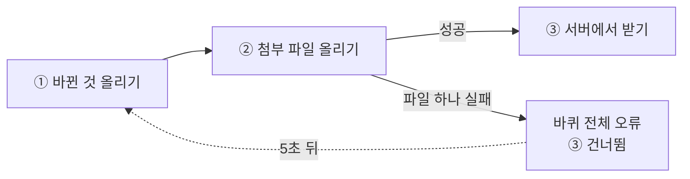

# 체크봇 저장소 전체 점검 (ponytail-audit, 2026-10-30)

점검만 했고 코드는 하나도 고치지 않았다. 순서는 버그 → 보안 → 부하 → 테스트 → 속도 → 군더더기이고, 목적이 "압축"이라 지울 것·합칠 것·줄일 것은 아래 [압축 목록](#압축-목록)에 따로 다 모았다.

## 이 저장소가 하는 일

MS To Do 화면을 본뜬 개인 할 일 앱이다. 같은 웹 코드(Preact)를 PC에서는 Tauri 앱으로, 아이폰에서는 PWA(홈 화면에 까는 웹앱)로 쓴다. 데이터는 먼저 기기 안 저장소(IndexedDB, Dexie)에 쓰고, 5초마다 Supabase 서버와 필드 단위로 맞춘다(같은 칸을 두 기기가 고치면 나중 것이 이긴다). Claude가 할 일을 읽고 쓰는 통로가 둘 있다: PC 통로 `tools/todo-agent`(명령줄과 감시자)와 원격 통로 `supabase/functions/todo-mcp`(Claude 앱의 커넥터).

**가정한 부하:** 사용자 한 명. 기기 2~3대(PC 앱, 아이폰, 갤럭시)와 Claude 통로 3개(PC 명령줄, PC 감시자, 원격 커넥터)가 같은 계정에 동시에 붙는다. 레코드는 수천 개. 이 기준에서는 동시 접속이나 서버 부하로 깨질 곳은 찾지 못했다. 문제는 대부분 "한 기기에서 한 번 일어나면 계속 남는" 종류다.

## 꼭 고칠 것

### 1. 첨부 파일 하나가 안 올라가면 그 기기는 더 받지 못함
- **위치:** `src/data/sync.js:L126-135` (첨부 올리기), `src/data/sync.js:L96-103` (오류 처리)
- **무엇:** 동기화 한 바퀴는 ① 바뀐 것 올리기 → ② 첨부 파일 내용 올리기 → ③ 서버에서 받기 순서로 돈다.
- **문제:** ②에서 파일 하나라도 오류가 나면(서버 크기 제한을 넘는 큰 파일, 끊긴 연결 등) 바퀴 전체가 오류로 끝나 ③ 받기를 건너뛴다. 다음 바퀴도 같은 파일에서 또 멈춘다. 첨부 크기를 미리 막는 곳이 없다(`actions.js:L200` `addFile`). 예: 폰에서 수십 MB 동영상을 붙이면 그 폰은 PC에서 고친 것을 계속 못 받는다.
- **고침:** 올리기를 파일마다 `try/catch`로 감싸 실패한 파일은 다음 바퀴로 넘기고 나머지는 계속한다. 테스트 하나(가짜 서버의 `upload`가 오류를 던져도 받기가 도는지)를 같이 둔다.
- **안 고치면:** 그 기기만 조용히 옛 상태에 머문다. 설정 → 진단에 오류가 뜨지만 원인이 파일인지 알기 어렵다.
- **줄 수:** 약 +2줄(테스트 별도 약 +15줄) · **위험도:** 낮음 · **동작 변화:** 있음(실패한 파일이 있어도 받기는 계속됨)

### 2. 새 기기에서 기본 목록 '작업'의 설정이 처음값으로 덮임
- **위치:** `src/data/actions.js:L21-24` (`ensureInbox`), `src/ui/App.jsx:L86`
- **무엇:** 앱이 켜질 때 기기 안에 기본 목록 '작업'(id `inbox`)이 없으면 새로 만든다.
- **문제:** 새 기기(또는 iOS가 PWA 저장소를 비운 아이폰)에서는 서버에서 받기 전에 이 함수가 먼저 돈다. 이때 모든 칸에 "지금" 시각을 찍어 만들고, 동기화 ①에서 먼저 올린다. 필드 단위로 나중 시각이 이기므로 서버의 '작업' 목록 테마·정렬·완료 펼침 상태가 `blue`·`manual`·닫힘으로 돌아가고, 모든 기기에 퍼진다. (코드 흐름으로 판단, 실기에서 재현은 안 해 봄)
- **고침:** 이 한 레코드만 시각을 1(아주 옛날)로 찍어 만든다. 서버에 이미 있으면 서버 값이 이기고, 없으면 그대로 만들어진다. `insert`에 시각을 넘길 자리를 하나 둔다.
- **안 고치면:** 기기를 새로 붙일 때마다 '작업' 목록 꾸밈과 정렬이 처음값으로 돌아간다.
- **줄 수:** 약 +2줄 · **위험도:** 중간(동기화 규칙을 건드림) · **동작 변화:** 있음

### 3. Ctrl+Alt+T를 다른 프로그램이 잡고 있으면 PC 앱이 아예 안 켜짐
- **위치:** `src-tauri/src/lib.rs:L174`
- **무엇:** 앱이 켜질 때 빠른 추가 단축키 Ctrl+Alt+T를 등록한다.
- **문제:** 끝의 `?` 때문에 등록에 실패하면 시작 준비 전체가 실패하고, `lib.rs:L200`의 `expect`로 앱이 꺼진다. 다른 프로그램이 같은 단축키를 먼저 잡으면 체크봇이 켜지지 않는다. (실기에서 재현은 안 해 봄)
- **고침:** `let _ = app.global_shortcut().register(quick_add);` 로 실패를 무시한다. 단축키만 안 되고 앱은 켜진다.
- **안 고치면:** 어느 날 새 프로그램을 깔고 나서 체크봇이 이유 없이 안 켜진다.
- **줄 수:** 0줄 · **위험도:** 낮음 · **동작 변화:** 있음(단축키 없이도 켜짐)

### 4. 설정 '주의 시작 요일'이 아무 데도 안 쓰임
- **위치:** `src/ui/Settings.jsx:L111`, `src/data/settings.js:L12`, `src/ui/kit.jsx:L196-197`
- **무엇:** 설정 화면에서 주의 시작 요일(일/월)을 고를 수 있다. 원본 기준선 기능(S-06)이다.
- **문제:** 이 값을 읽는 곳이 없다. 날짜 고르기 달력은 늘 일요일부터 그린다(`start.setDate(1 - first.getDay())`). 기본값은 월요일(1)이라 설정 화면과 달력이 처음부터 어긋난다.
- **고침:** 달력에 `weekStart`를 넘겨 `1 - ((first.getDay() - weekStart + 7) % 7)`로 시작하고, 요일 머리글도 같은 만큼 돌린다.
- **안 고치면:** 월요일을 골라도 달력은 일요일부터 나온다.
- **줄 수:** 약 +3줄 · **위험도:** 낮음 · **동작 변화:** 있음

### 5. 반복 작업을 끝내거나 목록을 복제하면 단계 메모·목록 태그가 빠짐
- **위치:** `src/core/complete.js:L29`, `src/data/actions.js:L265-268`
- **무엇:** 반복 작업을 끝내면 다음 회차 작업을 만들고 단계를 복사한다. 목록 복제도 할 일과 단계를 복사한다.
- **문제:** 단계를 복사할 때 `title`·`done`·`order`만 옮기고 단계 메모(`note`, 단계 메모 기능)는 버린다. 목록 복제는 목록의 `tags`(도구 태그 기능)도 버린다. 예: 매일 반복 작업의 단계 "약 먹기"에 "아침 식후 2알"이라고 적어 두면, 오늘 끝낸 뒤 내일 작업의 단계에는 메모가 없다. 이 두 칸은 복사 코드보다 나중에 생긴 기능이라 빠진 것으로 보인다.
- **고침:** 두 곳의 단계 복사에 `note: s.note`, 목록 복제의 `pick` 목록에 `'tags'`를 더한다. 원격 통로 복사본은 `node scripts/build-mcp.mjs`로 다시 만든다.
- **안 고치면:** 반복 작업의 단계 메모를 매번 다시 적어야 한다.
- **줄 수:** 0줄(같은 줄 안에서 고침) · **위험도:** 낮음 · **동작 변화:** 있음

## 고치면 좋은 것

### 6. 원격 통로의 명령 처리가 PC 통로 명령을 거의 그대로 다시 씀 (합칠 것)
- **위치:** `supabase/functions/todo-mcp/tools.js:L173-262` (`HANDLERS`), `tools/todo-agent/todo.mjs`의 명령 분기
- **무엇:** 원격 커넥터의 도구 11개(`todo_add`, `todo_step`, `todo_finish` 등)와 PC 명령(`todo add`, `todo step`, `todo finish` 등)은 하는 일이 같다.
- **문제:** 두 쪽 다 `api.mjs`(읽기)·`write.mjs`(변경 만들기)를 쓰지만, 그 사이의 "찾기 → 검사 → 변경 만들기 → 올리기" 순서를 각자 따로 적었다. 한쪽만 고치면 PC 통로와 원격 통로가 다르게 동작한다.
- **고침:** 명령 하나의 순서를 `write.mjs`(또는 새 공용 함수)에 한 번만 두고, `todo.mjs`는 명령줄 인자를, `tools.js`는 MCP 인자를 그 함수에 넘기기만 한다.
- **안 고치면:** 기능을 더할 때마다 두 곳을 고치고, 하나를 잊는다.
- **줄 수:** 약 -60줄 · **위험도:** 중간(두 통로 모두 다시 시험해야 함) · **동작 변화:** 없음

### 7. 앱과 PC 통로가 "새 할 일 위치·번호, 목록 추가·삭제" 규칙을 따로 가짐 (합칠 것)
- **위치:** `src/data/actions.js` (`createTask`, `createList`, `deleteList`, `minOf`/`maxOf` `L18-19`), `tools/todo-agent/write.mjs` (`addChanges`, `listAddChanges`, `listRmChanges`, `minOf`/`maxOf` `L35-36`)
- **무엇:** 새 할 일을 맨 위/맨 아래 어디에 둘지, 작업 번호를 몇으로 줄지, 목록을 지우면 무엇을 같이 지울지 정하는 규칙이다.
- **문제:** 같은 규칙이 앱(Dexie에 바로 씀)과 통로(변경 목록을 만듦)에 두 벌 있다. 한쪽만 바꾸면 Claude가 넣은 할 일과 내가 넣은 할 일의 순서·번호가 달라진다.
- **고침:** 계산 부분(위치·번호·지울 대상 고르기)만 순수 함수로 `src/core/`에 옮겨 두 쪽이 같이 쓴다. `src/core`는 이미 원격 통로에도 복사되므로 세 곳이 한 규칙을 쓴다.
- **안 고치면:** 규칙이 조금씩 갈라진다.
- **줄 수:** 약 -30줄 · **위험도:** 중간 · **동작 변화:** 없음

### 8. 할 일 추가 칸이 두 벌 (합칠 것)
- **위치:** `src/ui/ListPane.jsx:L227-239` (`AddTask.submit`), `src/ui/ListPane.jsx:L427-439` (`AddSheet.submit`)
- **문제:** PC의 추가 칸과 폰의 추가 시트가 똑같은 13줄로 할 일을 만든다. 한쪽만 고치면 PC와 폰이 다르게 넣는다.
- **고침:** 같은 파일에 `submitNew(...)` 하나를 두고 두 곳이 부른다.
- **안 고치면:** 기한·반복 처리 같은 작은 차이가 생긴다.
- **줄 수:** 약 -10줄 · **위험도:** 낮음 · **동작 변화:** 없음

### 9. 반복 메뉴가 두 벌 (합칠 것)
- **위치:** `src/ui/menus.jsx:L69-83` (`repeatMenu`, 이미 있는 할 일), `src/ui/ListPane.jsx:L267-276` (`addRepeatMenu`, 추가 칸)
- **문제:** 매일·평일·매주·매월·매년·사용자 지정 메뉴를 두 번 적었다. 차이는 "고른 값을 어디에 넣나"뿐이다.
- **고침:** `repeatMenu(ui, cur, due, set)` 하나로 두고, 할 일 쪽은 `set`에 `patch`를 넘긴다.
- **안 고치면:** 메뉴 항목을 바꿀 때 한쪽을 잊는다.
- **줄 수:** 약 -10줄 · **위험도:** 낮음 · **동작 변화:** 없음

### 10. 할 일 삭제 함수가 두 벌 (합칠 것)
- **위치:** `src/ui/App.jsx:L202-216` (`swipeDelete`, `deleteTask`)
- **문제:** 밀어서 삭제와 메뉴·Delete 키 삭제가 거의 같은 일을 따로 한다. 다른 점은 밀어서 삭제만 확인을 껐을 때 "실행 취소" 알림을 띄우는 것이다.
- **고침:** `swipeDelete` 하나만 남기고 `deleteTask`가 그것을 부른다.
- **안 고치면:** 두 삭제 길이 계속 조금씩 다르다.
- **줄 수:** 약 -6줄 · **위험도:** 낮음 · **동작 변화:** 조금 있음(메뉴로 지워도 "실행 취소" 알림이 뜸)

### 11. 순서 바꾸기 함수가 두 벌 (합칠 것)
- **위치:** `src/data/actions.js:L151-161` (`reorder`), `src/data/actions.js:L170-176` (`reorderStep`)
- **문제:** 할 일과 단계의 끌어 놓기 순서 저장이 표 이름만 다르고 같다.
- **고침:** `reorder`에 표 이름을 받게 하고 `reorderStep`을 지운다.
- **줄 수:** 약 -6줄 · **위험도:** 낮음 · **동작 변화:** 없음

### 12. 기한 글을 만드는 함수가 두 벌 (합칠 것)
- **위치:** `src/core/dates.js:L25-42` (`fmtDay`, `fmtDueLong`)
- **문제:** "오늘/내일/○월 ○일" 글을 만드는 거의 같은 함수다. 한쪽만 고치면 목록과 상세 화면의 날짜 글이 달라진다.
- **고침:** 하나에 "길게" 옵션을 두고 다른 하나를 지운다.
- **줄 수:** 약 -6줄 · **위험도:** 낮음 · **동작 변화:** 없음

### 13. 안 쓰는 코드와 작은 겹침 묶음 (지울 것)
아무도 부르지 않거나(저장소 전체에서 검색해 확인), 한 줄짜리로 겹친 것들이다. 하나하나는 [압축 목록](#압축-목록)의 13a~13p에 적었다.
- **문제:** 읽는 사람이 "이걸 어디서 쓰지?"를 찾느라 시간을 쓴다.
- **고침:** 지운다. 테스트만 쓰는 것은 테스트도 함께 정리한다.
- **줄 수:** 약 -45줄 · **위험도:** 낮음 · **동작 변화:** 없음(13p는 화면에서 한 번 확인)

### 14. 한 번 쓰고 끝난 'MS To Do에서 가져오기' 기능 (지울 것, 사용자 결정)
- **위치:** `src/features/msimport/` (225줄), `tests/msimport.test.js` (119줄)
- **무엇:** MS To Do 내보내기 파일을 읽어 체크봇으로 옮기는 설정 메뉴다.
- **문제:** 데이터 이전은 이미 끝났다(기억 메모 기준). 다시 쓸 일이 없으면 344줄이 계속 검사·빌드에 들어간다.
- **고침:** 폴더와 테스트를 지운다. 기능 등록표에서 빠지므로 다른 코드는 안 고쳐도 된다. 다시 필요하면 태그 `v1-원본재현` 이후 기록에서 꺼낸다.
- **안 고치면:** 해는 없고 무게만 남는다.
- **줄 수:** 약 -344줄 · **위험도:** 낮음(되살리기 쉬움, 다만 지울지는 사용자가 정함) · **동작 변화:** 있음(설정의 가져오기 메뉴가 사라짐)

### 15. 원격 통로용 복사본 1,017줄이 저장소에 함께 올라가 있음 (줄일 것)
- **위치:** `supabase/functions/todo-mcp/_shared/` (10개 파일, 1,017줄), `scripts/build-mcp.mjs`
- **무엇:** 원격 통로는 `supabase/functions/` 밖 파일을 배포에 싣지 못해, `src/core` 등을 그대로 복사해 둔다. 테스트가 원본과 같은지 본다.
- **문제:** 같은 코드가 저장소에 두 번 있어, 원본을 고친 커밋마다 복사본도 같이 바뀌고 검색 결과도 두 배로 나온다.
- **고침:** `_shared/`를 `.gitignore`에 넣고, 원격 통로 배포 명령과 `npm run check`(Deno 검사) 앞에서 `build-mcp.mjs`를 먼저 돌린다.
- **안 고치면:** 지금처럼 동작은 맞지만 저장소가 무겁다.
- **줄 수:** 저장소에서 -1,017줄(읽고 고칠 코드 양은 그대로) · **위험도:** 중간(복사를 잊고 배포하면 옛 코드가 나감, 클라우드 세션 검사 순서도 바뀜) · **동작 변화:** 없음

## 있으면 좋은 것

### 16. 할 일 줄마다 전체 단계·파일을 다시 거름
- **위치:** `src/ui/TaskRow.jsx:L31-34`
- **문제:** 화면의 할 일 줄 하나하나가 모든 단계·파일 목록을 처음부터 걸러 자기 것을 찾는다. 줄 100개 × 단계 1,000개면 그릴 때마다 10만 번 비교한다. 지금 양에서는 느끼기 어렵다.
- **고침:** 부모에서 `taskId → 단계 수` 지도를 한 번 만들어 넘긴다.
- **줄 수:** 약 ±0줄 · **위험도:** 낮음 · **동작 변화:** 없음

### 17. 서버 요청 시간 제한 타이머를 끝나도 지우지 않음
- **위치:** `src/data/supa.js`의 `req()`
- **문제:** 요청이 일찍 끝나도 시간 제한 타이머(첨부 올리기는 120초)가 끝까지 남는다. 5초마다 동기화하니 타이머가 몇십 개 쌓였다 사라진다. 해는 거의 없다.
- **고침:** `finally`에서 `clearTimeout`.
- **줄 수:** +1줄 · **위험도:** 낮음 · **동작 변화:** 없음

이 밖에 작은 것 3개는 뺐다: 진단 기능의 20초 원격 확인 간격, 서비스 워커(`public/sw.js:L35-38`)가 오류 응답도 캐시에 넣는 것, 도구 목록 동기화(`toolsync.mjs:L98`)가 `--no-verify`로 자동 커밋하는 것(문서 한 파일만 담아 실제 해는 없음).

## 따로 적어 둔 결정(지적으로 세지 않음)

- **PC 감시자의 넓은 권한** (`tools/todo-agent/watch.mjs:L19-38`): `acceptEdits` + `git commit` + `npm test`가 열려 있어, 할 일 글이 시키는 대로 코드를 고치고 돌릴 수 있다. 2026-10-29 사용자 결정("감시자 권한을 넓히자")이고 주석에 이유가 적혀 있어 지적에서 뺐다. 다만 같은 주석은 "올리기는 저장소 설정이 정하고 push는 열지 않는다"고 하는데, 기본 목록의 `Bash(node scripts/sync.mjs:*)`는 push를 한다. 체크봇 저장소에서는 `.claude/settings.json`이 이미 같은 명령을 허용하므로 이 줄은 겹치는 설정이다(13o).
- **보안 쪽에서 본 것:** 서버 표의 행 단위 권한(RLS), 원격 통로의 로그인 토큰 확인(`auth.js`, JWKS·ES256), 동의 화면의 돌아갈 주소 검사(`consent.js`), 앱에 publishable 키만 있는 것, `push_changes`의 필드별 시각 비교를 읽었다. 문제는 찾지 못했다.

## 압축 목록

지울 것·합칠 것·줄일 것 전부. "줄 수"는 대략이고, 테스트 줄은 따로 적은 것만 넣었다.

### 지울 것

| 번호 | 파일:줄 | 무엇이 문제인가 | 줄 수 | 위험도 | 동작 변화 |
|---|---|---|---|---|---|
| 13a | `src/ui/menus.jsx:L177,L181` | `dueMenuMobile`의 `withNone` 인자를 아무도 넘기지 않음 | -2 | 낮음 | 없음 |
| 13b | `src/ui/menus.jsx:L230`, `L6` | `DatePicker`를 다시 내보내지만 아무도 여기서 가져가지 않음 | -1 | 낮음 | 없음 |
| 13c | `src/core/tasknum.js:L49-52` | `numberedLists` 안 씀 | -4 | 낮음 | 없음 |
| 13d | `src/core/views.js:L4` | `SMART` 안 씀 | -1 | 낮음 | 없음 |
| 13e | `src/core/agent.js:L13` | `isAgent` 안 씀 | -1 | 낮음 | 없음 |
| 13f | `tools/todo-agent/vault.mjs:L52` | `exists` 안 씀 | -1 | 낮음 | 없음 |
| 13g | `src/data/sync.js:L51-54` | `configure` 안 씀 | -4 | 낮음 | 없음 |
| 13h | `src/data/repo.js:L6` | `newId` 내보내기 안 씀 | -1 | 낮음 | 없음 |
| 13i | `tools/todo-agent/todo.mjs:L40-41` | `TOOL_TABLE` 다시 내보내기 안 씀 | -2 | 낮음 | 없음 |
| 13j | `tools/todo-agent/todo.mjs:L6-23` | 맨 위 사용법 주석이 아래 `USAGE` 글과 같은 내용 | -18 | 낮음 | 없음 |
| 13k | `src/features/agent/pick.js:L30,L44` | `inAgentList`·`agentCount`는 테스트만 씀 | -2(+테스트) | 낮음 | 없음 |
| 13l | `src/features/registry.js:L26-32` | `featureItems`가 `collect`를 그대로 부르기만 함(부르는 곳 약 20곳 이름만 바꿈) | -3 | 낮음 | 없음 |
| 13m | `src/data/sync.js:L219-220` | 한 번만 돌면 되는 받기 위치 초기화(`pullFix`). 모든 기기가 이미 지남(추정) | -2 | 낮음 | 없음(추정) |
| 13o | `tools/todo-agent/watch.mjs:L33` | `node scripts/sync.mjs` 허용이 저장소 설정과 겹치고 주석과도 어긋남 | -1 | 낮음 | 없음 |
| 13p | `src/features/stepmemo/index.jsx:L42` | 메모 칸은 `autoFocus`로 이미 포커스를 받는데, 문서의 첫 메모 칸을 한 번 더 찾아 포커스. 다른 단계 메모가 이미 열려 있으면 그쪽을 잠깐 잡을 수 있음(화면 확인 안 함) | -1 | 낮음 | 화면에서 확인 필요 |
| 14 | `src/features/msimport/`, `tests/msimport.test.js` | 한 번 쓰고 끝난 가져오기 기능 | -344 | 낮음(사용자 결정) | 있음(메뉴 사라짐) |

### 합칠 것

| 번호 | 파일:줄 | 무엇이 문제인가 | 줄 수 | 위험도 | 동작 변화 |
|---|---|---|---|---|---|
| 13n | `src/core/tasknum.js:L34-35` | `codeOf`·`refOf`가 같은 식을 두 번 적음(`refOf`가 `codeOf`를 부르게) | ±0 | 낮음 | 없음 |
| 13q | `src/ui/menus.jsx:L89`, `L130` | 정렬 기준 목록을 PC 메뉴(`sortModes`)와 폰 시트(`modes`)에 두 번 적음 | -1 | 낮음 | 없음 |
| 8 | `src/ui/ListPane.jsx:L227-239`, `L427-439` | 추가 칸과 추가 시트의 `submit`이 똑같음 | -10 | 낮음 | 없음 |
| 9 | `src/ui/menus.jsx:L69-83`, `src/ui/ListPane.jsx:L267-276` | 반복 메뉴 두 벌 | -10 | 낮음 | 없음 |
| 11 | `src/data/actions.js:L151-161`, `L170-176` | `reorder`·`reorderStep` | -6 | 낮음 | 없음 |
| 12 | `src/core/dates.js:L25-42` | `fmtDay`·`fmtDueLong` | -6 | 낮음 | 없음 |
| 10 | `src/ui/App.jsx:L202-216` | `swipeDelete`·`deleteTask` | -6 | 낮음 | 조금 있음 |
| 7 | `src/data/actions.js`, `tools/todo-agent/write.mjs:L35-36` 외 | 새 할 일 위치·번호, 목록 추가·삭제 규칙 두 벌 | -30 | 중간 | 없음 |
| 6 | `supabase/functions/todo-mcp/tools.js:L173-262`, `tools/todo-agent/todo.mjs` | 원격 통로와 PC 통로의 명령 처리 두 벌 | -60 | 중간 | 없음 |

### 줄일 것

| 번호 | 파일:줄 | 무엇이 문제인가 | 줄 수 | 위험도 | 동작 변화 |
|---|---|---|---|---|---|
| 15 | `supabase/functions/todo-mcp/_shared/` | 원격 통로용 복사본을 저장소에 올림 | 저장소 -1,017 | 중간 | 없음 |

## 압축 후보 표 (위험도 낮은 순)

같은 위험도 안에서는 줄어드는 양이 큰 것부터.

| 순서 | 번호 | 할 일 | 줄 수 | 위험도 | 동작 변화 |
|---|---|---|---|---|---|
| 1 | 14 | MS To Do 가져오기 기능 지우기(사용자 결정) | -344 | 낮음 | 있음(메뉴 사라짐) |
| 2 | 13j | `todo.mjs` 맨 위 사용법 주석 지우기 | -18 | 낮음 | 없음 |
| 3 | 8 | 추가 칸·추가 시트 `submit` 합치기 | -10 | 낮음 | 없음 |
| 4 | 9 | 반복 메뉴 두 벌 합치기 | -10 | 낮음 | 없음 |
| 5 | 11 | `reorder`·`reorderStep` 합치기 | -6 | 낮음 | 없음 |
| 6 | 12 | `fmtDay`·`fmtDueLong` 합치기 | -6 | 낮음 | 없음 |
| 7 | 10 | `swipeDelete`·`deleteTask` 합치기 | -6 | 낮음 | 조금 있음 |
| 8 | 13c | `numberedLists` 지우기 | -4 | 낮음 | 없음 |
| 9 | 13g | `configure` 지우기 | -4 | 낮음 | 없음 |
| 10 | 13l | `featureItems` 지우고 `collect` 직접 부르기 | -3 | 낮음 | 없음 |
| 11 | 13a | `withNone` 인자 지우기 | -2 | 낮음 | 없음 |
| 12 | 13i | `TOOL_TABLE` 다시 내보내기 지우기 | -2 | 낮음 | 없음 |
| 13 | 13k | `inAgentList`·`agentCount`(테스트만 씀) 지우기 | -2 | 낮음 | 없음 |
| 14 | 13m | `pullFix` 한 번짜리 초기화 지우기 | -2 | 낮음 | 없음(추정) |
| 15 | 13b | `DatePicker` 다시 내보내기 지우기 | -1 | 낮음 | 없음 |
| 16 | 13d | `SMART` 지우기 | -1 | 낮음 | 없음 |
| 17 | 13e | `isAgent` 지우기 | -1 | 낮음 | 없음 |
| 18 | 13f | `vault.exists` 지우기 | -1 | 낮음 | 없음 |
| 19 | 13h | `newId` 내보내기 지우기 | -1 | 낮음 | 없음 |
| 20 | 13o | 감시자 기본 허용의 `sync.mjs` 한 줄 지우기 | -1 | 낮음 | 없음 |
| 21 | 13q | 정렬 기준 목록 한 번만 적기 | -1 | 낮음 | 없음 |
| 22 | 13p | 단계 메모 포커스 줄 지우기 | -1 | 낮음 | 화면 확인 필요 |
| 23 | 13n | `codeOf`·`refOf` 같은 식 한 번만 | ±0 | 낮음 | 없음 |
| 24 | 15 | `_shared/` 복사본을 저장소에서 빼기 | 저장소 -1,017 | 중간 | 없음 |
| 25 | 6 | 원격 통로·PC 통로 명령 처리 합치기 | -60 | 중간 | 없음 |
| 26 | 7 | 앱·PC 통로의 할 일·목록 규칙 합치기 | -30 | 중간 | 없음 |

위험도 "높음"인 압축 후보는 없다.

## 판정

**판정:** 대체로 튼튼하다. 먼저 1(첨부 하나가 받기를 막음)과 3(단축키 충돌 시 앱이 안 켜짐)을 고치고, 다음으로 2(새 기기에서 '작업' 목록 설정 덮임)를 테스트와 함께 고친다.

**군살:** 코드 약 -520줄 가능(가져오기 기능 344줄 포함), 저장소에서는 복사본까지 약 -1,540줄. 지울 수 있는 의존성은 0개(5개 모두 쓰임).

## 읽지 않은 부분

- **훑기만 하거나 안 읽음:** `scripts/install-pc.mjs`, `scripts/deploy-pages.mjs`, `scripts/server-check.mjs`, `scripts/deno-check.mjs`, `scripts/edge.mjs`, `scripts/watch-autostart.mjs`, `scripts/tidy-tools.mjs`, `.github/workflows/check.yml`
- **안 읽음:** `src/styles.css`, `src/ui/motion.js`, `src/ui/icons.jsx`, `src/features/badge/draw.js`, `tests/` 안의 테스트 본문(이름과 대상만 확인), `.claude/skills/`, `docs/`(개발 구조 문서만 읽음), `Cargo.lock`·`package-lock.json`, `src-tauri/src/`의 `lib.rs` 밖 파일(작업 표시줄 배지 감시 등)
- **돌려 보지 않음:** `npm run check`, 앱 실행, 실기(PC 앱·아이폰·갤럭시). 1·2·3번은 코드 흐름으로 판단했고 재현하지 않았다.
- **읽음(문제 없음):** `public/sw.js`, `public/oauth/consent/consent.js`, `vite.config.js`, `.github/workflows/pages.yml`, `scripts/check.mjs`·`check-lock.mjs`·`sync.mjs`·`ship.mjs`·`build-mcp.mjs`, `supabase/schema.sql`·`config.toml`, 원격 통로 `index.ts`·`http.js`·`auth.js`·`mcp.js`
